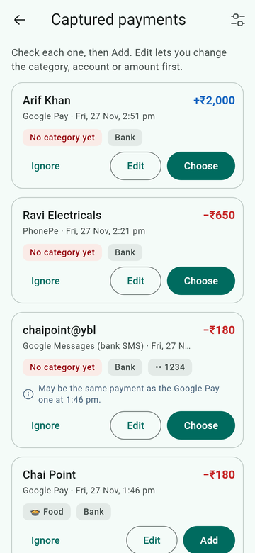
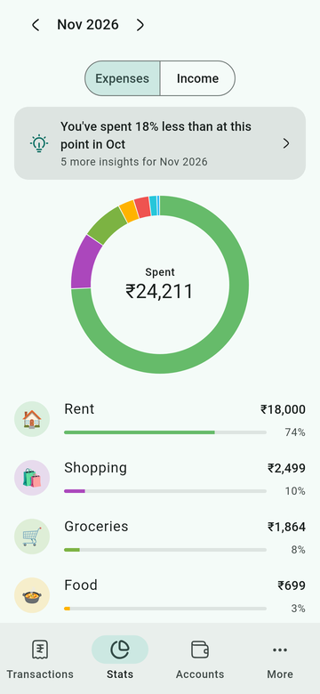

<p align="center">
  
</p>

<h1 align="center">Finance Tracker</h1>

<p align="center">
  A personal expense and income tracker for Android, in Indian rupees, that keeps its data on the phone.
</p>

<p align="center">
  <a href="https://github.com/muhammedshehzad/Finance-Tracker/actions/workflows/android.yml"></a>
  
  
  
</p>

<p align="center">
  
  
  
  
</p>

## Contents

- [Features](#features)
- [Tech stack](#tech-stack)
- [Getting started](#getting-started)
- [Configuration](#configuration)
- [Building and releasing](#building-and-releasing)
- [Project structure](#project-structure)
- [Permissions and privacy](#permissions-and-privacy)
- [Roadmap](#roadmap)

## Features

**Adding entries.** Every entry is shown for review first, and nothing is saved until you confirm it.

- **Screenshot:** reads the amount, payee, date and UPI reference from a Google Pay, PhonePe, Paytm or bank receipt. A payment history screenshot adds every payment on it at once. Uses Gemini when it is set up, and on-device OCR otherwise.
- **Voice:** turns "paid 450 for lunch and 120 for auto in cash" into two drafts. Handles mixed English and Hindi, k, thousand and lakh.
- **Payment capture:** reads payment notifications from UPI apps and bank SMS. Captured payments wait as pending under *More → Captured payments* until you add, edit or ignore them. A payment seen in both an app and an SMS is flagged so it is added once, and OTPs, requests and failed payments are dropped.
- **Excel and CSV import:** detects the columns, and lets you map accounts and categories before anything is written. Importing the same file twice adds nothing.

**Managing money**

- Accounts for cash, bank, wallet, credit card and money lent, with opening balances and net worth
- Recurring payments (rent, EMIs, subscriptions, salary) with reminders
- Monthly and per-category budgets
- Savings goals with progress and the monthly amount needed
- Daily, calendar and monthly views, a category breakdown, search, and monthly insights against the previous month

**Data and security**

- Backup and restore of all data as one file, with weekly automatic backup to a folder on the phone and to Google Drive
- CSV export
- App lock with fingerprint, face or the phone's PIN
- Light and dark themes

## Tech stack

| Area | Choice |
|---|---|
| UI | Flutter, Material 3 (`material_ui`), Hugeicons |
| State | Riverpod |
| Storage | SQLite (`sqflite`) |
| Reading receipts and voice | Gemini through Firebase AI Logic, with ML Kit OCR and Android speech recognition offline |
| Payment capture | Kotlin `NotificationListenerService` with a method channel |
| Backup | Storage Access Framework folder, Google Drive REST (`drive.appdata`) |
| CI | GitHub Actions |

## Getting started

**Requirements:** Flutter 3.50 or newer, the Android SDK, and a phone or emulator running Android 7.0 or newer.

```bash
git clone https://github.com/muhammedshehzad/Finance-Tracker.git
cd Finance-Tracker
flutter pub get
flutter run
```

The app works without any configuration. Gemini and Google Drive are optional and are set up below.

**Tests**

```bash
flutter analyze
flutter test
```

The tests cover the receipt, voice and notification parsers, the database and its migrations, backup and restore, the importer, insights, goals and the recurring schedule, with a smoke test that opens every screen. To re-render the screens, run `flutter test test_screens --update-goldens` and look in `test_screens/out/`.

## Configuration

### Gemini (optional)

Screenshots and voice notes are read more accurately by Gemini. The app reaches it through [Firebase AI Logic](https://firebase.google.com/docs/ai-logic), so no API key ships in the app.

1. Create a project in the [Firebase console](https://console.firebase.google.com) and turn on **AI Logic** with the **Gemini Developer API**.
2. Add an Android app with the package name `com.shehzad.finance_tracker` and the SHA-1 and SHA-256 of your release key.
3. Under **App Check**, add a debug token for the Android app.
4. Download `google-services.json` and turn it into build settings. The generated file is ignored by git.
   ```bash
   dart run tool/firebase_env.dart path/to/google-services.json YOUR_DEBUG_TOKEN
   ```
5. Build with `--dart-define-from-file=firebase.env.json`. For CI, store the file's contents in a `FIREBASE_ENV_JSON` secret.

Anyone with the APK could extract the debug token, so don't share the APK, and revoke the token if it leaks. The default model is `gemini-3.5-flash-lite`; set `GEMINI_MODEL` in `firebase.env.json` to change it.

### Google Drive backup (optional)

Drive backups go to the app's hidden `appDataFolder`, which only this app can read. Set up once in the Google Cloud project behind your Firebase project:

1. Enable the **Google Drive API**.
2. In **Google Auth Platform**, fill in **Branding**, set **Audience** to **External**, and add your Google account as a test user or publish the app.
3. Under **Data Access**, add the `.../auth/drive.appdata` scope.
4. Under **Clients**, make sure there is an **Android** client with the package name and your signing key's SHA-1. A debug build needs a second client with the debug key's SHA-1.

In Testing mode, Google ends access after seven days. Backing up by hand with *Back up now* signs in again; for uninterrupted weekly backups, publish the app.

## Building and releasing

The project builds two editions from the same code and data:

| Edition | Payment capture | Install from |
|---|---|---|
| `full` | Yes | USB (`adb install`) |
| `lite` | No | Anywhere |

Play Protect blocks sideloaded apps that request notification access in some countries, including India, so the full edition is installed over USB:

```bash
flutter build apk --release --flavor full --split-per-abi
adb install -r build/app/outputs/flutter-apk/app-arm64-v8a-full-release.apk
```

**Signing.** Create one release key and sign every build with it, since Android only installs updates signed with the same key.

```bash
keytool -genkey -v -keystore finance-tracker.jks -keyalg RSA -keysize 2048 -validity 10000 -alias finance-tracker
```

For local builds, add `android/key.properties` (ignored by git):

```properties
storeFile=/absolute/path/to/finance-tracker.jks
storePassword=...
keyAlias=finance-tracker
keyPassword=...
```

**CI.** Every push to `main` runs the analyzer and tests and builds both editions. To get signed APKs as build artifacts, add these repository secrets: `ANDROID_KEYSTORE_BASE64`, `ANDROID_KEYSTORE_PASSWORD`, `ANDROID_KEY_ALIAS` and `ANDROID_KEY_PASSWORD`. Pushing a tag such as `v1.0.0` also publishes a GitHub release.

## Project structure

```
lib/
  core/       money and date helpers
  data/       models, SQLite schema and migrations, repository
  services/   parsers, backup, recurring engine, reminders, export,
              ai/ (Gemini), import/ (Excel and CSV), capture/ (notifications)
  state/      Riverpod providers and actions
  ui/         screens, grouped by feature
android/      notification listener and platform channels (Kotlin)
test/         unit and widget tests
test_screens/ screenshot rendering
tool/         Firebase build settings helper
```

Amounts are stored as whole paise in integers. Transfers count as neither income nor expense, and money lent is tracked as an asset.

## Permissions and privacy

| Permission | Used for |
|---|---|
| Notification access | Payment capture, only from the apps switched on in settings |
| Microphone, Bluetooth | Voice entry, including from a Bluetooth headset |
| Notifications, run at startup | Payment reminders, rescheduled after a restart |
| Biometrics | App lock |
| Internet | Gemini and Google Drive backup, when set up |

Entries stay on the phone. Only a screenshot or voice note you choose to read with Gemini is sent to Google, and backups go only where you send them. OTPs are dropped before a notification is stored.

On Android 13 and later, the notification access switch is greyed out for sideloaded apps. Open *App info*, tap the menu, and choose *Allow restricted settings*.

## Roadmap

- Test payment capture with more banks and phones. Canara Bank SMS is confirmed on a real device; other banks are covered by unit tests only.
