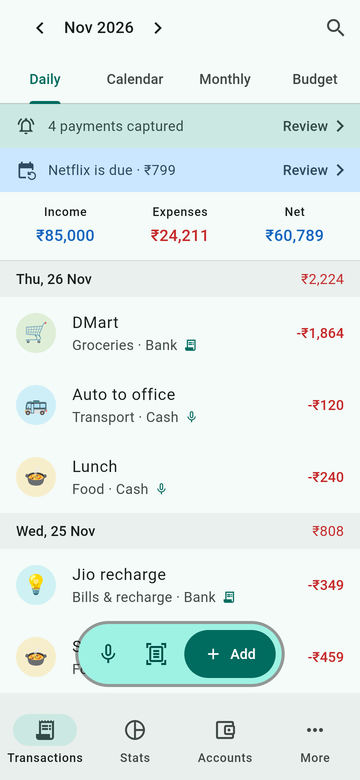
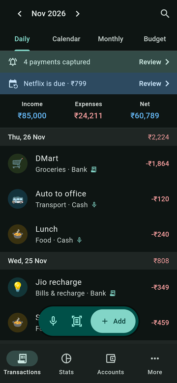
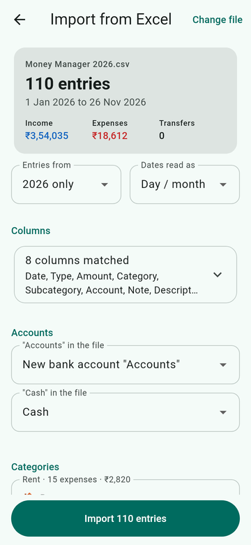
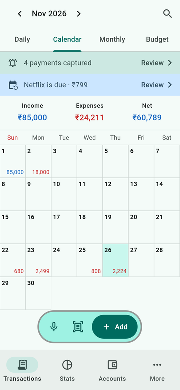
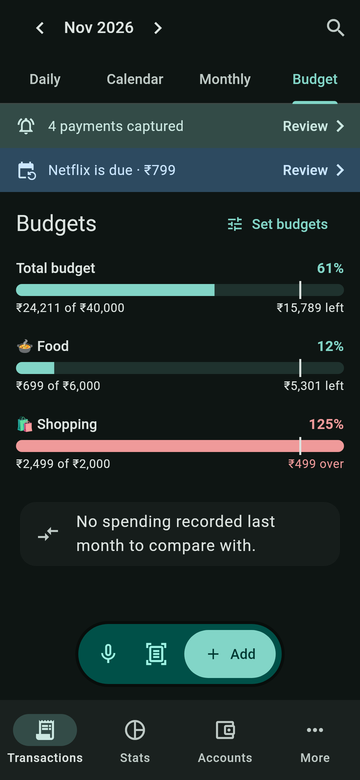

<p align="center">
  
</p>

<h1 align="center">Finance Tracker</h1>

<p align="center">
  <strong>Every rupee, accounted for, without typing it all in.</strong><br>
  Snap a payment screenshot, say what you spent, or let your UPI notifications do it.<br>
  Nothing is saved until you tap Add, and nothing leaves your phone.
</p>

<p align="center">
  
  
  
  
</p>

<p align="center">
  
  
  
  
</p>

## Four ways in, one tap to confirm

| | How it works |
|---|---|
| 📸 **Screenshot** | Pick a Google Pay, PhonePe, Paytm or bank receipt. On-device OCR fills in the amount, payee, date and UPI reference, and keeps the screenshot on the entry. The same UPI reference is never added twice. |
| 🎙️ **Voice** | Say *"paid 450 for lunch and 120 for auto in cash"* and get two drafts to check. Understands rupees, k, thousand, lakh, lending and card bills. |
| 🔔 **Notifications** | Google Pay, PhonePe, Paytm and BHIM payments, plus bank SMS if you switch it on, wait under Captured payments with the category already guessed. OTPs, requests, reminders and failed payments are dropped. |
| 📊 **Excel import** | Bring in a year of history from an `.xlsx` or `.csv` file. Columns are detected for you, you review how accounts and categories map before anything is written, and importing the same file again adds nothing. |

## Everything else

- **Recurring payments**: rent, EMIs, subscriptions and salary wait under *Due now* until you confirm, or record themselves if you prefer. A reminder fires before each one.
- **Views**: daily list, calendar, month by month, budgets with a pace marker, a stats donut by category, and search across every entry.
- **Accounts**: cash, bank, wallet, credit card and money lent to others, with opening balances and net worth.
- **Budgets**: an overall monthly limit plus limits per category.
- **Export**: a CSV of every entry, ready for Sheets or Excel.
- **Light and dark** themes that follow the system.

<p align="center">
  
  
  
  
  
</p>

## How the money works

- Amounts are whole paise in integers, so totals never drift.
- **A transfer is neither income nor expense.** Paying a card bill moves money from Bank to Credit card; the purchases already counted as expenses when you made them.
- **Lending isn't spending.** Money lent sits in a *Lent to others* account as an asset until it comes back.
- **Opening balances** make every balance and your net worth real figures, not just the change since day one.

## Getting started

```bash
flutter pub get
flutter run
```

Needs Flutter 3.50 or newer. Material widgets come from the `material_ui` package.

```bash
flutter analyze
flutter test
```

72 tests cover the receipt, voice and notification parsers, money formatting, the recurring schedule, the database and its migrations, and the Excel importer end to end, plus a smoke test that opens every screen with data in it. To re-render the screens in light and dark, run `flutter test test_screens --update-goldens` and look in `test_screens/out/`.

## Release builds

Every push to `main` runs the analyzer and tests, then builds a signed release APK you can download from the run's **Artifacts**, including from the GitHub app on your phone. Push a tag such as `v1.0.0` and the APK is also attached to a GitHub Release.

Android only installs an update signed with the same key as the installed app, and uninstalling deletes your entries. So create one release key, keep it safe, and sign every build with it.

**1. Create the key once.** `keytool` ships with Android Studio and every JDK.

```bash
keytool -genkey -v -keystore finance-tracker.jks -keyalg RSA -keysize 2048 -validity 10000 -alias finance-tracker
```

Back up the `.jks` file and both passwords outside this repository. Losing them means losing updates to the installed app.

**2. Add four repository secrets** under *Settings → Secrets and variables → Actions*:

| Secret | Value |
|---|---|
| `ANDROID_KEYSTORE_BASE64` | The `.jks` file in base64 (see below) |
| `ANDROID_KEYSTORE_PASSWORD` | The keystore password |
| `ANDROID_KEY_ALIAS` | `finance-tracker` |
| `ANDROID_KEY_PASSWORD` | The key password |

```bash
base64 -i finance-tracker.jks | pbcopy        # macOS
base64 -w0 finance-tracker.jks                # Linux
```

On Windows PowerShell: `[Convert]::ToBase64String([IO.File]::ReadAllBytes("finance-tracker.jks")) | Set-Clipboard`

**3. To build on your own machine with the same key**, create `android/key.properties`, which git ignores:

```properties
storeFile=/absolute/path/to/finance-tracker.jks
storePassword=...
keyAlias=finance-tracker
keyPassword=...
```

Then run `flutter build apk --release`. Without a key, a release build falls back to the debug key: fine for trying the app, but it can't update a build from CI.

CI uses the run number as the build number, so each APK installs over the last. A local build keeps the `+1` from `pubspec.yaml`, so it can't replace a newer CI build.

## Under the hood

```
lib/
  core/       money and date helpers
  data/       models, SQLite schema and migrations, FinanceRepository
  services/   receipt OCR and parser, voice parser, recurring engine,
              reminders, CSV export, import/ (Excel and CSV),
              capture/ (notification parser and sync)
  state/      Riverpod providers and FinanceActions
  ui/         screens, grouped by feature
android/      notification listener and its method channel (Kotlin)
test/         unit and widget tests
```

- **Local first.** SQLite through `sqflite`. No account, no server, no paid APIs.
- **Riverpod** holds the repository and every read model. All writes go through `FinanceActions`, which bumps a revision the read providers watch, so one save refreshes every screen. Tests swap the database and the notification channel through provider overrides.
- **Parsers are pure Dart.** Receipts, voice, notifications and spreadsheets are parsed without plugins, so every message shape is unit tested.
- **Capture comes in two halves.** A Kotlin `NotificationListenerService` keeps only notifications from the apps you allowed that mention an amount, and drops OTPs before anything touches disk. Dart parses them, pairs an app notification with its bank SMS, and waits for you.

## Permissions

| Permission | Why |
|---|---|
| Microphone, Bluetooth | Voice entry. Android's speech service may use the network unless the offline English (India) pack is installed. |
| Notifications, boot completed | Payment reminders, rescheduled after a restart. They use inexact alarms, so they can arrive a few minutes late. |
| Notification access | Payment capture, granted from *More → Payment capture*. Only the apps switched on there are read. |

Images come through the system photo picker, so there is no storage permission.

On Android 13 and later, the notification access switch is greyed out for an APK you installed yourself. Open *App info* for Finance Tracker, tap the three-dot menu, choose *Allow restricted settings*, then try again.

## Roadmap

- **Backup.** Data lives only on the phone, so uninstalling deletes it. CSV export works today; a Google Drive backup fits on top of the repository layer.
- **Capture on real devices.** The notification parser is tested against real message shapes, but the listener itself is still to be tried across phones and banks.
