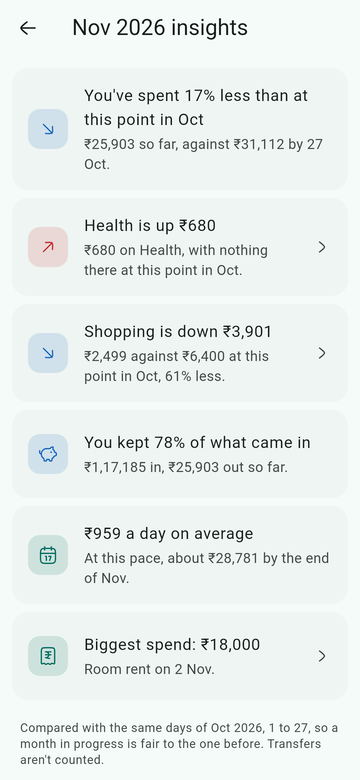
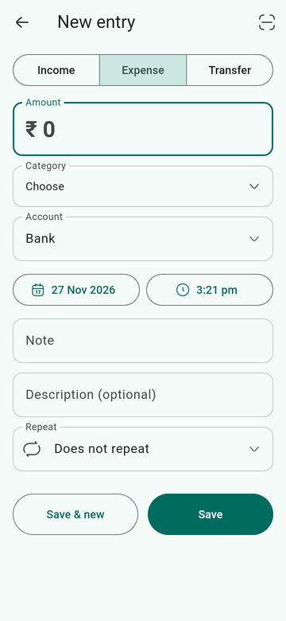
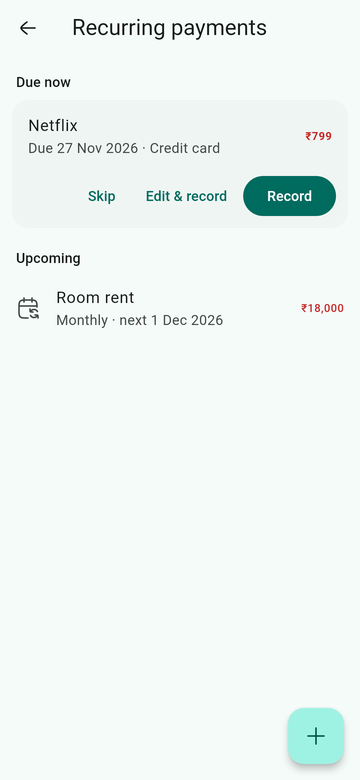
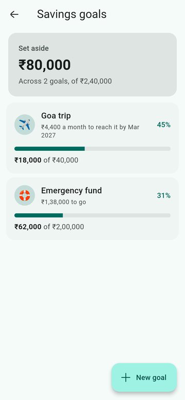
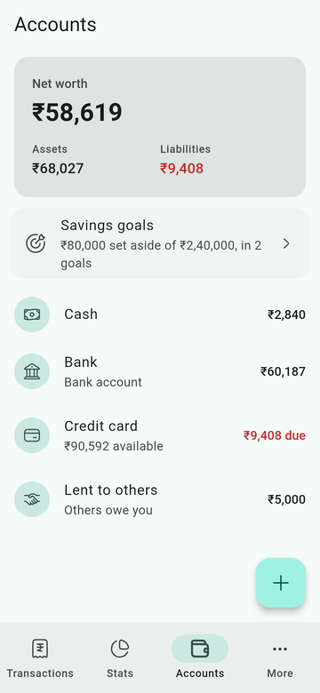
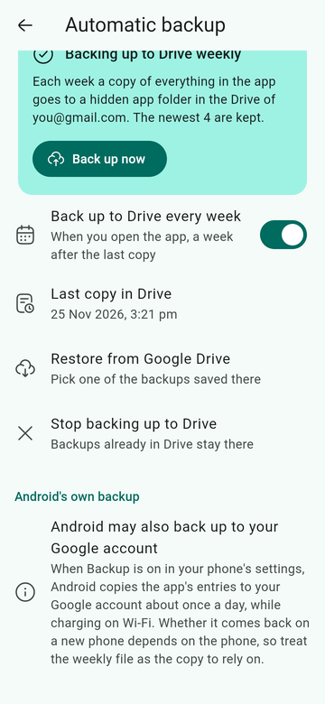
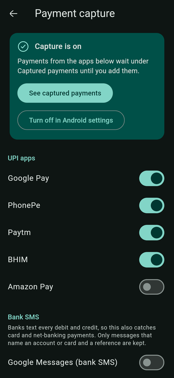

<p align="center">
  
</p>

<h1 align="center">Finance Tracker</h1>

<p align="center">
  <strong>Every rupee, accounted for, without typing it all in.</strong><br>
  Snap a payment screenshot, say what you spent, or let your UPI notifications do it.<br>
  Nothing is saved until you tap Add, and your entries never leave your phone.
</p>

<p align="center">
  <a href="https://github.com/muhammedshehzad/finance-tracker/actions/workflows/android.yml"></a>
  
  
  
  
</p>

<p align="center">
  
  
  
  
</p>

## Four ways in, one tap to confirm

| | How it works |
|---|---|
| 📸 **Screenshot** | Pick a Google Pay, PhonePe, Paytm or bank receipt. Gemini reads the amount, payee, date and UPI reference, or on-device OCR does when Gemini is off or offline, and the screenshot stays on the entry. A payment history screenshot adds every payment on it in one go, with ones you already have left unticked. The same UPI reference is never added twice. |
| 🎙️ **Voice** | Say *"paid 450 for lunch and 120 for auto in cash"* and get two drafts to check. Gemini writes down what you said, even in mixed English and Hindi, and the phone's own recogniser takes over offline. Understands rupees, k, thousand, lakh, lending and card bills. |
| 🔔 **Notifications** | Google Pay, PhonePe, Paytm and BHIM payments, plus bank SMS if you switch it on, wait under *More → Captured payments* as pending, with the category already guessed. Nothing is recorded until you tap **Add**, **Edit** or **Ignore**. Bank SMS are read in the shapes HDFC, SBI, ICICI, Axis and Canara use, including Canara's short *Dr.* and *Cr.*, so card and net-banking payments are caught too. The same payment seen in an app and in an SMS is flagged so you add it once, and SMS still in the notification shade are checked again when you open the app. OTPs, requests, reminders and failed payments are dropped. |
| 📊 **Excel import** | Bring in a year of history from an `.xlsx` or `.csv` file. Columns are detected for you, you review how accounts and categories map before anything is written, and importing the same file again adds nothing. |

## Everything else

- **Recurring payments**: rent, EMIs, subscriptions and salary wait under *Due now* until you confirm, or record themselves if you prefer. A reminder fires before each one.
- **Views**: daily list, calendar, month by month, budgets with a pace marker, a stats donut by category, and search across every entry.
- **Monthly insights**: how this month compares with the same days of last month, which category rose or fell most, what you kept of your income, the daily average and where it's heading, the biggest spend and the place you paid most often.
- **Accounts**: cash, bank, wallet, credit card and money lent to others, with opening balances and net worth.
- **Budgets**: an overall monthly limit plus limits per category.
- **Savings goals**: put money aside toward a trip or a fund, see how far along it is, and with a date, what to put in each month. A goal only keeps track, so balances and spending don't change.
- **Backup and restore**: all your data in one file you can keep in Drive, and back on a new phone in two taps. Automatic backup saves one every week to a folder you pick, to a hidden app folder in your Google Drive, or both, keeping the newest four in each, and restores from Drive on a new phone. Android's own backup can also copy the entries to your Google account.
- **Export**: a CSV of every entry, ready for Sheets or Excel.
- **App lock**: asks for your fingerprint, face or phone PIN when the app opens, and again after a minute away. It uses the phone's own screen lock, so nothing new to remember.
- **Light and dark** themes that follow the system.

<p align="center">
  
  
  
  
  
</p>

<p align="center">
  
  
  
  
  
</p>

## How the money works

- Amounts are whole paise in integers, so totals never drift.
- **A transfer is neither income nor expense.** Paying a card bill moves money from Bank to Credit card; the purchases already counted as expenses when you made them.
- **Lending isn't spending.** Money lent sits in a *Lent to others* account as an asset until it comes back.
- **Opening balances** make every balance and your net worth real figures, not just the change since day one.

## Getting started

```bash
flutter pub get
flutter run
```

Needs Flutter 3.50 or newer. Material widgets come from the `material_ui` package. `flutter run` uses the full build; add `--flavor lite` for the lite one.

```bash
flutter analyze
flutter test
```

131 tests cover the receipt, voice and notification parsers, monthly insights, savings goals, app lock, automatic backup to a folder and to Google Drive, how Gemini's answers are checked, spotting payments you already have, saving several from one screenshot, money formatting, the recurring schedule, the database and its migrations, backup and restore, and the Excel importer end to end, plus a smoke test that opens every screen with data in it. To re-render the screens in light and dark, run `flutter test test_screens --update-goldens` and look in `test_screens/out/`.

## Installing on your phone

The same code builds two editions. They are the same app with the same data, so you can switch between them without losing entries.

| Edition | Payment capture | Installs from |
|---|---|---|
| **Full** | Yes | USB only |
| **Lite** | No | Anywhere: a browser, a file manager or a chat app |

In India and several other countries, Play Protect blocks any app that asks for notification access when it comes from a browser, file manager or chat app, and offers no way to install it anyway. Payment capture needs that access, so the full edition goes in over USB, with USB debugging switched on:

```bash
flutter build apk --release --flavor full --split-per-abi
adb install -r build/app/outputs/flutter-apk/app-arm64-v8a-full-release.apk
```

`-r` replaces the installed app and keeps your entries. Updates to the full edition go in the same way.

## Reading with Gemini

Screenshots and voice notes are read far more accurately by Gemini than on the phone. The app talks to it through [Firebase AI Logic](https://firebase.google.com/docs/ai-logic) with the Gemini Developer API, so no Gemini key ships in the app. A build without Firebase settings works fully offline, and any build falls back to the phone when Gemini can't be reached.

**What leaves the phone.** Only the screenshot you add or the voice note you record, sent to Google to be read. Entries and accounts stay on the phone, and backups go only where you send them. On the free tier, Google may use what is sent to improve its products, and people may review it; a project with billing turned on keeps it out of that. *More → Reading screenshots and voice* says which applies to the installed build.

**Set it up once:**

1. Create a project in the [Firebase console](https://console.firebase.google.com). Google Analytics isn't needed.
2. Open **AI Logic**, choose **Get started** and pick the **Gemini Developer API**.
3. In **Project settings**, add an Android app with the package name `com.shehzad.finance_tracker`. Add the SHA-1 and SHA-256 of your release key, which this prints:
   ```bash
   keytool -list -v -keystore finance-tracker.jks -alias finance-tracker
   ```
4. Firebase blocks AI Logic calls that lack App Check, and Play Integrity only vouches for apps installed from Play. So open **Security → App Check → Apps**, open the Android app's menu, choose **Manage debug tokens**, and add a token.
5. Download `google-services.json` and turn it and the token into build settings. Both files stay out of git:
   ```bash
   dart run tool/firebase_env.dart ~/Downloads/google-services.json YOUR-DEBUG-TOKEN
   ```
6. Build with them:
   ```bash
   flutter build apk --release --flavor full --split-per-abi --dart-define-from-file=firebase.env.json
   ```
7. For CI, add a repository secret named `FIREBASE_ENV_JSON` holding the contents of `firebase.env.json`.

**About the debug token.** Anyone holding your APK could pull the token out and spend your Gemini quota, so don't share the APK, and revoke the token in the console if it leaks. On the free tier the worst case is hitting the limit; with billing on, set a budget alert. A build without the token tries Play Integrity, which works once the app comes from Play. To try another model, add `"GEMINI_MODEL"` to `firebase.env.json`; the default is `gemini-3.5-flash-lite`.

## Backing up to Google Drive

*More → Automatic backup → Sign in with Google* copies the weekly backup into the app's own hidden folder in your Drive (the `drive.appdata` scope). Only this app can open that folder, and the app can't see anything else in your Drive. Turn off *Back up to Drive every week* and Drive only gets a copy when you tap *Back up now*. Every copy holds everything in the app, so the newest is always complete. *Restore from Google Drive* lists those backups, for instance on a new phone. The backups are plain JSON, so whatever is in the app is readable by Google on its servers, like anything else in your Drive.

Google only gives this access to a copy of the app it knows, so **set it up once** in the Google Cloud project behind your Firebase project (the console's project picker shows the same name):

1. Open [APIs & Services → Library](https://console.cloud.google.com/apis/library/drive.googleapis.com), search for **Google Drive API** and choose **Enable**.
2. Open **Google Auth Platform**. If it asks, fill in **Branding** with an app name and your email.
3. Under **Audience**, choose **External**. While the app is in **Testing**, add your Gmail address under **Test users**. Google ends a test user's access seven days after they allow it, so the weekly run will stop and ask you to sign in again about once a week. Tapping *Back up now* signs you in again on the spot, so if you only back up by hand, Testing is fine. To keep the weekly run going, choose **Publish app**.
4. Under **Data Access**, choose **Add or remove scopes** and add `.../auth/drive.appdata`.
5. Under **Clients**, look for an **Android** client with the package name `com.shehzad.finance_tracker` and your release key's SHA-1 (Firebase may already have made one). If there isn't one, choose **Create client → Android** and enter both. The SHA-1 comes from the same `keytool` command as in step 3 of *Reading with Gemini*. A debug build needs a second client with the debug key's SHA-1.

Nothing changes in the app's code or build settings: Google checks the package name and signing key of the installed app. If something is missing, the app says Google sign-in isn't set up for this copy.

## Release builds

Every push to `main` runs the analyzer and tests, then builds signed release APKs of both editions for 64-bit ARM phones, with Gemini on when the `FIREBASE_ENV_JSON` secret is set, which covers phones from the last several years. Download them from the run's **Artifacts**. Push a tag such as `v1.0.0` and they are also attached to a GitHub Release.

Android only installs an update signed with the same key as the installed app, and uninstalling deletes your entries. So create one release key, keep it safe, and sign every build with it.

**1. Create the key once.** `keytool` ships with Android Studio and every JDK.

```bash
keytool -genkey -v -keystore finance-tracker.jks -keyalg RSA -keysize 2048 -validity 10000 -alias finance-tracker
```

Back up the `.jks` file and both passwords outside this repository. Losing them means losing updates to the installed app.

Until the signing secrets below are set, CI only checks that both editions build, and uploads nothing.

**2. Add four repository secrets** under *Settings → Secrets and variables → Actions*:

| Secret | Value |
|---|---|
| `ANDROID_KEYSTORE_BASE64` | The `.jks` file in base64 (see below) |
| `ANDROID_KEYSTORE_PASSWORD` | The keystore password |
| `ANDROID_KEY_ALIAS` | `finance-tracker` |
| `ANDROID_KEY_PASSWORD` | The key password |

```bash
base64 -i finance-tracker.jks | pbcopy        # macOS
base64 -w0 finance-tracker.jks                # Linux
```

On Windows PowerShell: `[Convert]::ToBase64String([IO.File]::ReadAllBytes("finance-tracker.jks")) | Set-Clipboard`

**3. To build on your own machine with the same key**, create `android/key.properties`, which git ignores:

```properties
storeFile=/absolute/path/to/finance-tracker.jks
storePassword=...
keyAlias=finance-tracker
keyPassword=...
```

Then run `flutter build apk --release --flavor full --split-per-abi`. Without a key, a release build falls back to the debug key: fine for trying the app, but it can't update a build from CI.

CI uses the run number as the build number, so each APK installs over the last. A local build keeps the `+1` from `pubspec.yaml`, so it can't replace a newer CI build.

## Under the hood

```
lib/
  core/       money and date helpers
  data/       models, SQLite schema and migrations, FinanceRepository
  services/   receipt OCR and parser, voice parser and recorder, backup,
              recurring engine, reminders, CSV export, ai/ (Gemini),
              import/ (Excel and CSV), capture/ (notification parser and sync)
  state/      Riverpod providers and FinanceActions
  ui/         screens, grouped by feature
android/      notification listener and its method channel (Kotlin);
              the full flavor's manifest is the only place the listener is declared
test/         unit and widget tests
tool/         turns google-services.json into build settings
```

- **Local first.** SQLite through `sqflite`. No account and no server. Gemini is optional, and every Gemini answer is checked field by field and shown to you before anything is saved.
- **Riverpod** holds the repository and every read model. All writes go through `FinanceActions`, which bumps a revision the read providers watch, so one save refreshes every screen. Tests swap the database and the notification channel through provider overrides.
- **Parsers are pure Dart.** Receipts, voice, notifications and spreadsheets are parsed without plugins, so every message shape is unit tested.
- **One look and one pace.** Every icon comes from Hugeicons through `ui/icons.dart`, and every animation, the loader included, takes its timing from `ui/motion.dart`. Animations turn off when Android's "Remove animations" setting is on.
- **Capture comes in two halves.** A Kotlin `NotificationListenerService` keeps only notifications from the apps you allowed that mention an amount, and drops OTPs before anything touches disk. Dart parses them, pairs an app notification with its bank SMS, and waits for you.

## Permissions

| Permission | Why |
|---|---|
| Microphone, Bluetooth | Voice entry. With Gemini on, the note is recorded and sent to Google to be written down. Offline, Android's speech service listens, and may itself use the network unless the offline English (India) pack is installed. |
| Notifications, boot completed | Payment reminders, rescheduled after a restart. They use inexact alarms, so they can arrive a few minutes late. |
| Notification access | Payment capture, granted from *More → Payment capture*. Only the apps switched on there are read. |
| Biometric | App lock. The phone checks the fingerprint or PIN itself; the app only learns whether it matched. |

Images come through the system photo picker, so there is no storage permission.

On Android 13 and later, the notification access switch is greyed out for an APK you installed yourself. Open *App info* for Finance Tracker, tap the three-dot menu, choose *Allow restricted settings*, then try again.

## Roadmap

- **Capture on more phones and banks.** It works on a real phone with Canara Bank SMS through Google Messages. Other banks' SMS are covered by tests built from their usual wording, but not yet tried on a phone.
